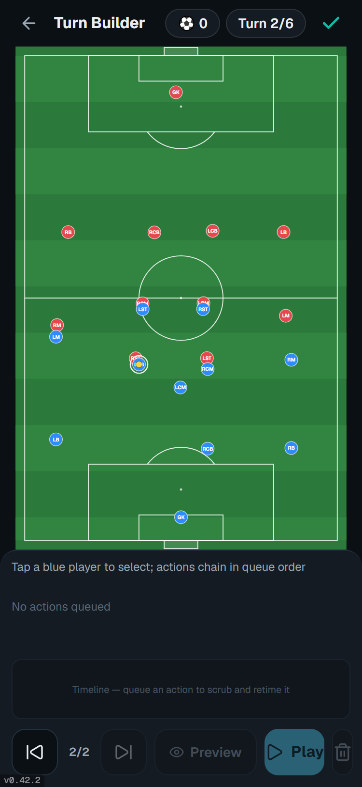
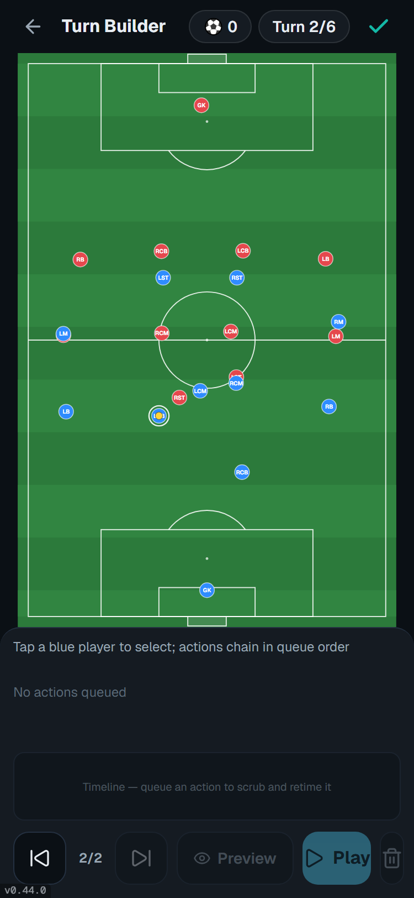
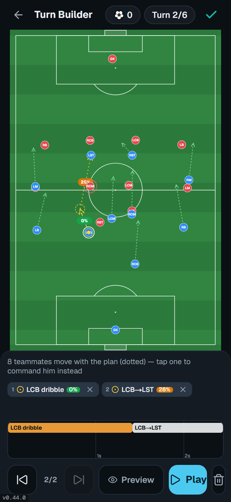

# LCB carry + dribble → pass — checked on the production build (v0.44.0)

Stefan's playtest feedback (2026-10-26): (1) the UI cannot give a dribble then a pass; (2) the game
should stop when the last command ends; (3) when LCB carries the ball up, the team does not follow.
Fixed in PR #38 (v0.43.0, items 1–2) and PR #39 (v0.44.0, item 3).

Phone size (375 × 812), https://soccer-play-builder.vercel.app/builder, dice pinned so nothing is lost.
Script: `lcb-check.mjs` (T1: LCB is given the ball, dribbles 20 m straight up, 18 m → 38 m. T2: LCB
dribbles on, then the user taps LST).

| | Deployment | Commit |
|---|---|---|
| before | `dpl_6wntbMEDcp2AdpSji6PZesYiQkoc` | `c85ffbe` (v0.42.2) |
| after | `dpl_4tmoTr8CBv8hXo92WZmNHeJpknbk` | `c6a83df` (v0.44.0) |

## T1 — metres each teammate moves up the pitch while LCB carries 20 m

| | LB | RCB | RB | LM | LCM | RCM | RM | LST | RST |
|---|---|---|---|---|---|---|---|---|---|
| before | +2 | +2 | 0 | +8 | −1 | +3 | +3 | +3 | +3 |
| after | +19 | +9 | +20 | +18 | +9 | +10 | +20 | +17 | +17 |

Before, LCB ended level with his own midfield. After, the midfield and forwards are ahead of him,
the full-backs are level, and RCB stays 11 m behind as cover.

## T2 — dribble, then tap a teammate

- before: the LST tap selects LST. The queue stays `LCB dribble`.
- after: the queue is `LCB dribble 0% | LCB→LST 28%`. The pass leaves from the dribble end.
  After the dribble tap the status says "LCB dribbles first — tap a teammate to pass from there,
  the goal to shoot, or LCB to finish".

No console errors on either build.
